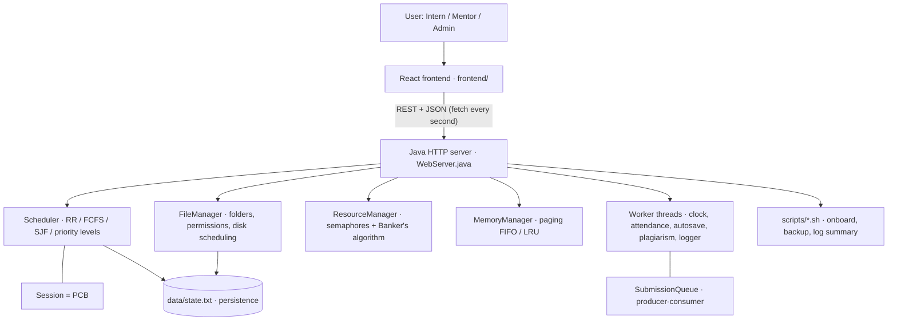

# INTERNSYNC · Virtual Internship Management System
Operating Systems PBL (CCSE0303A) · Group 65 · **Java backend + React (Lovable) frontend**

Every internship session is treated as an operating-system **process**. Mentor/server time is the **CPU**. The website shows the real OS logic that runs in Java.



## Folder structure
```
backend/    Java server (no framework, no library)   src/vims/*.java, scripts/, web/ (small built-in dashboard)
frontend/   React + TanStack Start site made in Lovable, now connected to the backend
README.md   this file
```

## How to run (two terminals)
**1. Backend** (needs JDK 17+)
```
cd backend
run.bat        (Windows)      or      ./run.sh      (Linux / Mac)
```
It prints `Server started: open http://localhost:8081`. The API is at http://localhost:8081/api/state.

**2. Frontend** (needs Node.js 20+; `npm` comes with it)
```
cd frontend
npm install
npm run dev
```
Open the address that Vite prints. The top bar shows **JAVA BACKEND ONLINE** when the connection works; otherwise the pages show demo data and a warning.
If your backend runs on another address, copy `.env.example` to `.env` and change `VITE_API_URL`.

## Demo roles (no passwords)
On the login page choose **Intern**, **Mentor** or **Admin**, then *Demo Login*.
| Role | Menu |
|---|---|
| Intern | Sessions (only own), Process Monitor, Files, Logs |
| Mentor | Overview, Sessions, Mentors (review queue), Synchronization, Logs |
| Admin | everything: Scheduler, Threads, Deadlock, Memory, File System, Backups … |

## Which page shows which OS concept (and which Java file does the work)
| Page | OS concept | Java file |
|---|---|---|
| Sessions / Process Monitor | process, PCB, process states | `Session.java`, `SessionState.java` |
| CPU Scheduler | Round Robin, FCFS, SJF, priority, Gantt, waiting/turnaround | `Scheduler.java`, `AlgorithmComparison.java` |
| Threads | multithreading (5 worker threads) | `Workers.java`, `Logger.java` |
| Synchronization | mutex, semaphores, bounded buffer | `SubmissionQueue.java`, `ResourceManager.java` |
| Deadlock | Banker's algorithm, safe sequence | `ResourceManager.java`, `Banker.java` |
| Memory | paging, frames, FIFO / LRU, page faults | `MemoryManager.java`, `PagingSimulator.java` |
| File System | directories, rwx permissions, disk scheduling (FCFS/SSTF) | `FileManager.java` |
| Backups | shell scripting | `scripts/*.sh` |
| Mentors | producer–consumer, review resources | `Scheduler.java`, `Workers.java` |
| (restart safe) | persistent storage | `Persistence.java` |

## Viva demo script (5 minutes)
1. Login as **Admin** → Sessions → *Load demo (5 sessions)*.
2. CPU Scheduler → Round Robin, quantum 2 → average waiting **11.2**, turnaround **15.6** (calculated by Java). Change to SJF (6.0 / 10.4) and show the comparison table.
3. Deadlock → *Run Safety Check*; run the textbook example (safe sequence P1 → P3 → P4 → P0 → P2). Create 5 HIGH priority sessions to see a request refused as unsafe.
4. Memory → switch FIFO / LRU and run the simulator: FIFO 15 faults, LRU 12 faults (3 frames).
5. Login as **Mentor** → Mentors → view a submission, plagiarism %, give feedback.
6. Files → folders and permissions; Backups → run `backup.sh`. Stop the Java server, start it again: everything is still there.

## Tests
```
cd backend
./run.sh            (compiles into backend/out; stop it with Ctrl+C)
java -cp out vims.SelfTest      → 22 checks must print PASS
```

## API (all in `backend/README.md`)
`/api/state`, `/api/sessions`, `/api/sessions/{pid}`, `/api/simulate`, `/api/banker`, `/api/paging`, `/api/files`, `/api/algorithm`, `/api/policy`, `/api/feedback`, `/api/backup`, `/api/login` …

## Put it on GitHub (first time)
```
git init
git add .
git commit -m "INTERNSYNC: Java backend + React frontend"
git branch -M main
git remote add origin https://github.com/<your-username>/virtual-internship-management-system.git
git push -u origin main
```
Later changes: `git add .` → `git commit -m "what you changed"` → `git push`.
Never commit passwords or keys (`.env` is ignored by `.gitignore`).

## Team contributions
Fill in from your Progress Report: Nandani (team leader, scheduling), Priyanka (research, deadlock/memory), Priti (documentation, shell scripts), Rishabh (design, PCB/files), Rehan (threads, testing).
